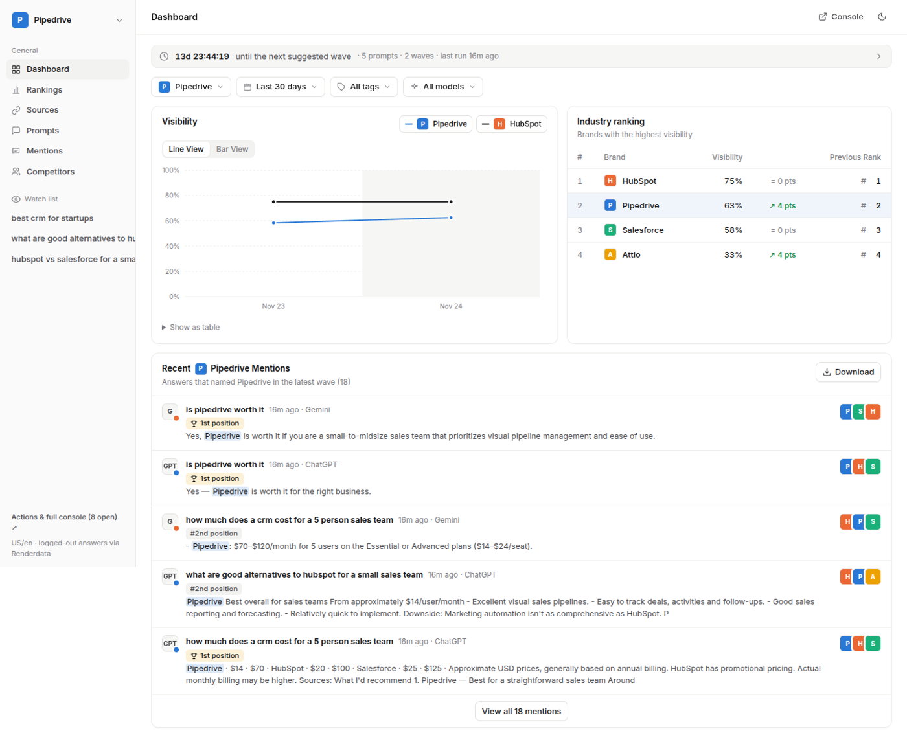
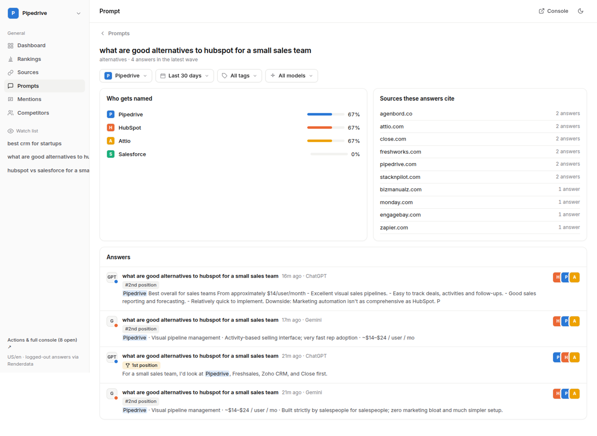
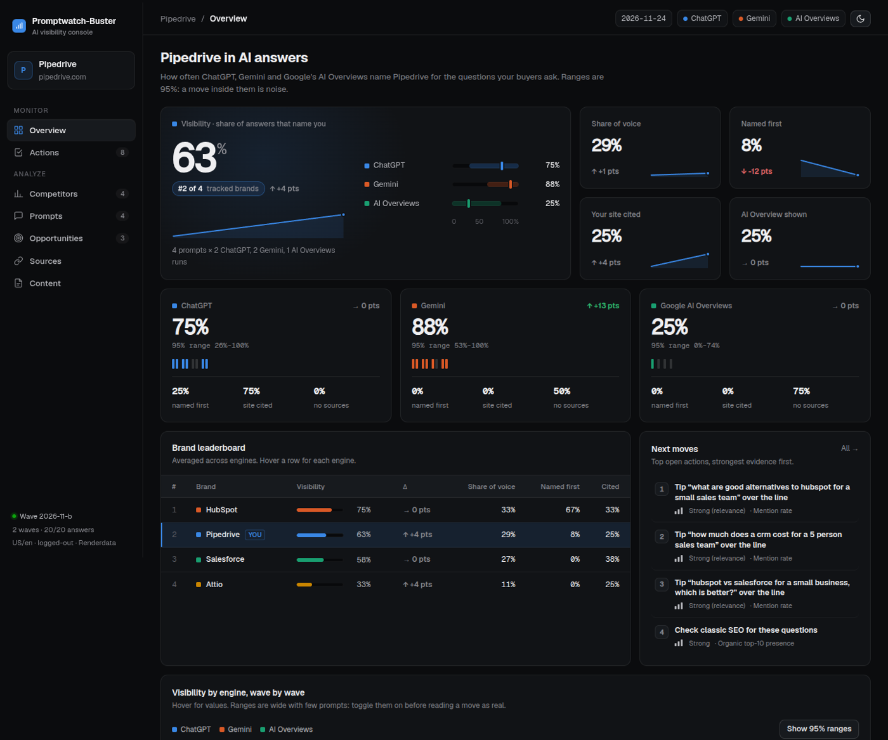
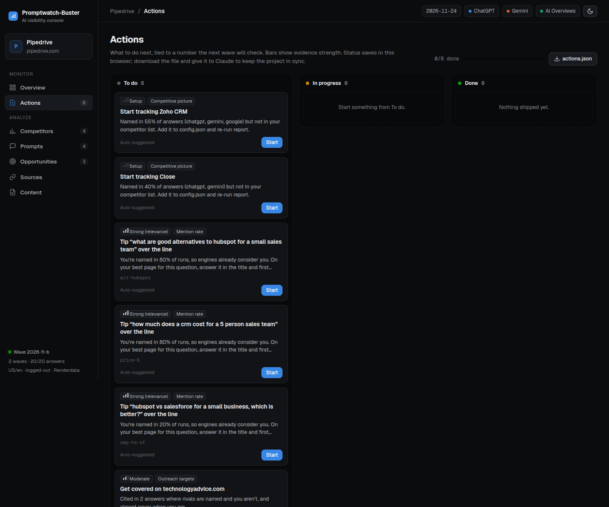

# promptwatch-buster

**Find out how often ChatGPT, Gemini and Google's AI Overviews recommend your brand, who they recommend instead, and what to do about it. Runs inside Claude Code.**

A Claude Code skill (packaged as a plugin) that runs your real buyer questions through the AI engines, measures how often each brand gets named, and turns the results into a ranked action plan and two dashboards. It costs about **$0.001 per answer**.



## Install

**One line, in your terminal** (macOS, Linux, WSL):

```bash
curl -fsSL https://raw.githubusercontent.com/Manasbh/promptwatch-buster/main/install.sh | bash
```

It installs the plugin through the `claude` CLI, or copies the skill into `~/.claude/skills` if the CLI isn't on your PATH. Read [install.sh](install.sh) first if you like; it's 30 lines.

**Or inside Claude Code**, run these as **two separate commands**, one at a time:

```
/plugin marketplace add Manasbh/promptwatch-buster
```

```
/plugin install promptwatch-buster@promptwatch-buster
```

**Or just ask Claude Code:** "install the plugin from github.com/Manasbh/promptwatch-buster".

Then get a Renderdata API key at **[platform.renderdata.cloud/keys](https://platform.renderdata.cloud/keys)**. Sign in with your email; you get 10 free credits with no card. Set the key in your shell:

```bash
export RENDERDATA_API_KEY=your_key
```

Start Claude Code and ask something like:

> Track our AI visibility against HubSpot and Salesforce. Here's our Search Console export.

Or type `/promptwatch-buster`.

**Manual:** clone this repo and copy `skills/promptwatch-buster` into `~/.claude/skills/`.

**Update:** `claude plugin update promptwatch-buster@promptwatch-buster` (or re-run the one-liner).

## What it does

1. **Builds a realistic prompt panel.** It takes your Google Search Console and Bing Webmaster exports, keeps the question-like queries, rewrites keyword fragments into how people actually ask an AI, and keeps search demand on each prompt.
2. **Plans before spending.** It shows the credits, dollars, time and expected precision, and waits for your yes.
3. **Runs the panel** through ChatGPT, Gemini and Google (AI Overview plus organic results) via [Renderdata](https://renderdata.cloud), several times per prompt. AI answers are random, so one run proves nothing.
4. **Reports honestly.** It gives mention, named-first and citation rates per engine with 95% ranges that treat the prompt as the unit, so noise doesn't look like a trend.
5. **Finds the competition.** It shows share of voice, brands the engines name that you don't track, gaps where rivals win and you don't, and prompts you're close to winning.
6. **Finds the sources.** It shows which domains get cited when each brand is named, outreach targets cited when rivals win, and pages that name rivals but not you.
7. **Checks your content.** It compares the searches ChatGPT runs behind the scenes against your sitemap, so you see which questions have no page.
8. **Writes an action plan.** Claude writes 5–10 prioritized actions, each tied to a number the next wave will check, with an evidence tier (no AEO myths).
9. **Proves impact.** Repeat waves give paired changes and a treated-vs-holdout comparison, so you can tell a real win from noise.

## Two dashboards

`pwb.py dashboard` regenerates both for free. They're single HTML files you open locally, with no server.

| Monitor (`monitor.html`) | Console (`dashboard.html`) |
|---|---|
|  |  |
| Day-to-day view: visibility chart vs a rival, industry ranking, recent mentions with position badges, per-prompt answer pages. Filters for brand, date range, tags and model. | Analysis view: visibility score with 95% ranges, KPI sparklines, run tapes, leaderboard, competitors, opportunities, sources, content gaps. |

The **action board** lives in the console. Cards move from To do to In progress to Done, and the status file goes back to Claude:



## Why Renderdata

[Renderdata](https://renderdata.cloud) asks ChatGPT, Gemini and Google your questions in real logged-out sessions. It returns the full answer, its citations, the pages the engine read and the searches it ran, as JSON.

The usual alternative is DataForSEO. It costs more per AI answer and needs a **$50 minimum top-up** before you can make a single call. Renderdata is **$0.001 per answer** on every engine, starts with free credits, and its packs start at $10. Failed calls are free and credits never expire.

**Need higher limits?** Pay-as-you-go allows 2 calls at once and 30 a minute, so a 100-prompt wave takes a few hours. For bigger panels, several brands or frequent waves, upgrade to the **$30/month Renderdata plan** on the [pricing page](https://platform.renderdata.cloud/pricing).

## Cost

| Panel | Answers per wave | Cost per wave |
|---|---:|---:|
| 25 prompts × 3 engines × 3 runs | 225 | ~$0.23 |
| 100 prompts × 3 engines × 3 runs | 900 | ~$0.90 |

Renderdata charges about 1 credit (~$0.001) per successful call, and failed calls are free. Fetching cited pages with `pages` is 1 credit per page. Reports and dashboards are free to regenerate.

## What's inside

```
skills/promptwatch-buster/
├── SKILL.md                 # the workflow Claude follows
├── scripts/pwb.py           # stdlib-only Python CLI: init, seed, plan, run, report, pages, dashboard, diff, trend, selftest
├── assets/                  # dashboard templates
└── references/playbook.md   # what to do about each finding, evidence tiers, myths to refuse
```

`pwb.py` has no dependencies beyond Python 3.9+. Run `python3 skills/promptwatch-buster/scripts/pwb.py selftest` to check it.

## Limits

- Answers come from logged-out sessions in one country. Signed-in, personalized users may see different answers.
- Small panels give wide ranges. The reports say so, and so should you.
- Brand discovery and sitemap matching are heuristics. Check them before acting.
- The monitor loads brand logos from Google's favicon service, and both dashboards load a web font from Google Fonts. Your tracking data stays on your machine.

## Privacy

Your API key is read from the environment and never written to disk. Project folders hold scraped AI answers; keep them out of public repos (the included `.gitignore` does).

---

Not affiliated with Promptwatch, OpenAI, Google or Anthropic. MIT licensed.
